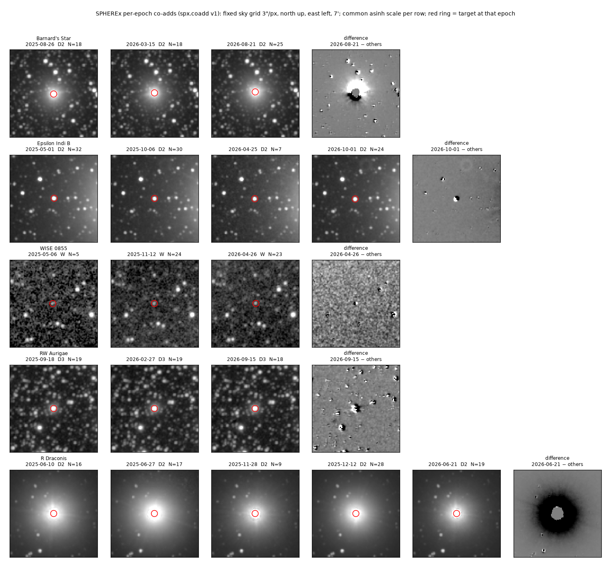

# Sci-Tech: SPHEREx Blink

A web tool for the NASA Space Apps Challenge 2026,
["Planet X and SPHEREx"](https://www.spaceappschallenge.org/2026/challenges/planet-x-and-spherex/).

Give it a sky position (RA, Dec) or an object name. It collects the SPHEREx images of that patch of sky taken at
different times, cleans and stacks them into one frame per visit, and plays the frames one after another like a
short film, so that objects that move or change brightness stand out. Click a point to get its infrared spectrum
from the same exposures.

The model is [WiseView](http://byw.tools/wiseview), which the challenge names as inspiration; what SPHEREx adds is
the spectrum. The tool does not claim any discovery. It makes looking easier.



## Status (15 November 2026)

- **Online:** <https://sci-techspherex.com/> opens the landing page; from its sky you reach the
  five challenge targets and their real SPHEREx frames (prebuilt under `web/data/`, no server needed). Try
  [WISE 0855](https://sci-techspherex.com/?target=wise-0855). The full tool, with every view
  and overlay, is at <https://sci-techspherex.com/tool/>.
- **The API server is online too** (Google Cloud Run, region us-east4, next to the data), so the published site
  takes any coordinate or name, your own wavelength window, the spectrum of a clicked point and the moving-object
  report. Fields are limited to 7′ there and requests are rate-limited. How it is deployed:
  [`DEPLOY.md`](DEPLOY.md).
- **A new position does not wait for IRSA's search services.** On 15 November 2026 IRSA's SIA2 and TAP services
  (the ones that answer "which images cover this position?") were down for hours, while the image files
  themselves, in the public bucket on AWS, stayed reachable. We read the pointing and the time of every Level 2
  file in that bucket, 1,628,230 files, and the server now carries that as its own index
  (`server/index/spx_index.npz`, 22.5 MB). It answers a position in a few hundredths of a second and says in the
  page where the list came from. See [How it works](#how-it-works) and [Limits](#limits).
- `web/` is the site as it is served (only `config.js` is written at publish time and the developer fixtures
  are left out): the landing page at its root (the story of the project, a sky to
  click, the frames of the five targets), the full tool under `web/tool/`, the gallery under `web/data/`.

## What it does

| Challenge item | In the tool |
|---|---|
| Enter RA/Dec, see the images as a short video | Blink player: play/pause, speed, frame slider with dates, arrow keys |
| Five test targets | Prebuilt gallery (Barnard's Star, Epsilon Indi B, WISE 0855, RW Aurigae, R Draconis) and the live path |
| Coordinates in the URL, embedding | `?ra=&dec=&fov=` or `?target=`; the URL carries the whole view; `?embed=1` and "copy embed code" |
| Easy update with new data releases | The list of collections is one setting (`SPX_COLLECTIONS`); `scripts/precompute.py` rebuilds the gallery |
| Co-add per detector | One frame per visit and detector band (D1 to D6) |
| Use the 102 bands | Your own wavelength window: drag a range on the spectrum and blink only the exposures taken at those wavelengths (50 nm or wider, live server) |
| Add or subtract images from different times | Blink, difference (one visit minus the mean of the others) and sum; an automatic finder that compares the visits and rings what moved or changed |
| Field of view | 3′ and 7′ on the published server; 15′ when you run the server yourself. The page states the cost of the large field before opening it: about 120 to 190 MB per band, 30 to 70 s per band from a home connection (`handoff/results/fov_timing_v2.json`, and the acceptance report) |
| Other telescopes | Gaia DR3 stars moved to each visit's date with their proper motion. For the five gallery targets, stored with the page: the WISE image (AllWISE W1 and W2, about 2010) on the same grid, which can be added to the blink as its first frame, and the CatWISE2020 catalogue as an overlay. A "More surveys" panel (Aladin Lite) shows AllWISE, 2MASS or DSS2 at the same place; link to WiseView |
| Metadata, contamination flags | Exposure count and dates per frame, coverage map, map of the masked fraction; for a clicked point, the names of the FLAGS bits set in each exposure, with their meaning from the SPHEREx Explanatory Supplement |
| Spectrum | Click a point: flux against wavelength from the single exposures, and against time |
| False colour | Three bands as red, green and blue |

Also in the tool:

- **Measure.** Mark a moving object in two or more frames; the page fits its shift, direction and rate.
- **Moving-object report.** The server measures the marked object again on the single exposures and offers the
  positions as CSV, and for Solar System objects as a draft in the Minor Planet Center's ADES format. It is a
  draft only: nothing is sent anywhere, the file is only downloaded.
- **Automatic candidates.** A classical detector (difference from the mean of the visits, matched filter,
  shift-and-stack along trial motions; no machine learning) rings places that moved or changed. Given only the
  field, with no position, it finds WISE 0855, Epsilon Indi B and Barnard's Star as movers and RW Aurigae as
  variable; it does not find R Draconis, which is saturated. Each candidate has a grade: A when it is seen in two
  independent wavelength ranges, or in three visits on a straight line, or is a known moving star; B when it is
  seen in one wavelength range only. The rings are places to look, not detection claims: in the five gallery
  fields the finder also rings 14 other spots, all grade B, that have not been confirmed.

## Run it

Python 3.13 was used. From the repository root:

```
python -m pip install -r requirements.txt

# the page (gallery works with this alone)
python -m http.server 8765 --bind 127.0.0.1 -d web

# the API server (free coordinates, name lookup, spectrum at a clicked point, reports)
uvicorn server.app:app --host 127.0.0.1 --port 8000
```

Open `http://127.0.0.1:8765/` for the landing page or `http://127.0.0.1:8765/tool/?target=wise-0855` for the full
tool. The pages look for the server named in `web/config.js`; without one they say so and keep the gallery. Tool
details and URL parameters: [`web/tool/README.md`](web/tool/README.md).

The moving-object report needs the ADES submission schema once: `python scripts/make_submit_xsd.py`.

Rebuild the gallery from the archive: `python scripts/precompute.py` (all five targets).

### When a new SPHEREx data release arrives

1. Add the new collection name to the list: set `SPX_COLLECTIONS` (for example
   `SPX_COLLECTIONS=spherex_dr2,spherex_dr1`) or edit `COLLECTIONS` in `spx/access.py`. Nothing else in the code
   names a release.
2. Restart the server. A new collection is asked from IRSA on the next request. Image lists are cached per
   collection for 7 days and built frames are kept on disk, so delete `cache/sia/` and `cache/fields/` to rebuild
   positions that were already built.
3. Rebuild our own index so that the new files are found without IRSA: add the release's bucket prefix to
   `RELEASES` in `scripts/build_s3_index.py` and to `COLLECTIONS` in `server/s3index.py`, run the workflow
   "Image index of the bucket" (or `python scripts/build_s3_index.py --out cache/s3index` on a fast connection),
   then `python -m server.s3index cache/s3index server/index/spx_index.npz` and commit the file.
4. Rebuild the gallery: `python scripts/precompute.py`. Each target's `provenance.json` records the collections,
   the exposure counts and the code version it was built from, and the page shows the date range of the data.

## How it works

```
browser (web/, static)                      server (server/, Python)
  manifest ───────────────────────────────►  image list (our index of the bucket; IRSA SIA2 for newer data) → visits, bands
  band, frame ────────────────────────────►  byte-range reads from the public S3 bucket → spx.access → spx.coadd → cache
  gaia, spectrum, resolve, track, report ─►  Gaia DR3 / spx.photometry / CDS Sesame / spx.astrometry, spx.mpc
  no server: the same file names under web/data/ (five targets)
```

1. **List.** The server finds every SPHEREx image that covers the position in its own index of the public
   bucket. The index holds, for each of the 1,628,230 Level 2 files of releases DR1 and QR3, the S3 key, the
   detector, the pointing (the TAN part of the file's own WCS) and the exposure times. It was made by reading
   8.6 kB of each file's header with one range request (`scripts/build_s3_index.py`; the whole bucket takes about
   a minute and a half on 20 parallel CI jobs, `.github/workflows/s3index.yml`) and merged by `python -m server.s3index`.
   A list that IRSA's SIA2 service gave earlier is used while it is still cached; exposures newer than the
   index are asked from IRSA in the background and added if it answers. The manifest field `image_list` and
   the tool's About tab say which source a field's list came from. Without the index file the server asks
   IRSA, as before.
2. **Pixels.** Each Level 2 file is about 66 MB. The server reads only the header and the rows it needs with HTTP
   range requests from the public bucket `nasa-irsa-spherex` (image, flags, variance).
3. **Frames.** Exposures are grouped into visits, masked with the FLAGS layer, background-subtracted, resampled
   onto one grid that is fixed on the sky (3″ pixels, north up) and combined with a clipped inverse-variance mean
   per visit and band. The grid does not follow the target, so a moving object changes place between frames.
4. **Display.** All frames of a band share one brightness scale, so blinking does not flicker.

Methods and measured numbers: [`handoff/results/methods_v2.md`](handoff/results/methods_v2.md).

## Layout

| Path | Content |
|---|---|
| `spx/` | Processing: archive access, co-add, display scale, photometry, single-exposure astrometry, candidate finder, ADES writer, targets |
| `server/` | FastAPI server and the build pipeline; `server/s3index.py` and `server/index/` are our own index of the bucket's images |
| `web/` | The published site: landing page at its root, the full tool in `web/tool/`, the prebuilt gallery in `web/data/` |
| `scripts/` | Gallery build, acceptance checks, small tools |
| `tests/` | Offline tests, and network tests that run with `SPX_NETWORK=1` |
| `handoff/results/` | Methods (`methods_v2.md`) and the measured result files that the tests write and the server reads |
| `docs/acceptance/` | Acceptance report of the gallery build |

## Tests

```
python -m pip install -r requirements-test.txt
python -m pytest -q tests
python scripts/acceptance.py --static-only
```

The acceptance report for the released gallery is `docs/acceptance/acceptance_20261114T225615Z.json`: 102 items
passed and 6 failed. All six are cold-cache timings measured from a home connection far from the data (image
list 5.2 to 6.2 s against a limit of 5 s; first band 31.5 s and 46.1 s against 30 s). No gallery, target or
correctness item failed. On the evening of 14 November the IRSA image-list service answered HTTP 502 to about two
of three queries. This run predates our own image index (15 November): the image-list timings were IRSA's
answer times and no longer apply to a new position, which now gets its list from the index.

## Limits

- SPHEREx pixels are 6.15″. Zooming in the page is cosmetic and labelled so. There is no deconvolution and no
  AI sharpening; nothing is shown that is not in the data.
- **R Draconis** is saturated in every exposure measured (412 of 412). Its brightness change is shown from the wings of the star's
  image and is labelled "indicative only, not a formal detection of variability".
- **Barnard's Star** has a saturated core; its spectrum points are lower limits.
- **RW Aurigae** is measured as variable in all six detector bands against control stars in the same images;
  two of the bands (D3, D4) rest on a single wavelength bin. Most of its points use pixels recovered from
  overflow, which are less accurate than clean ones.
- **WISE 0855** is faint: it is seen in a custom 4.3–5.0 µm window, not in the short bands. The source seen there
  at short wavelengths is a fixed background star (Gaia DR3 5756956644387831296), and the page says so.
- **Our image index** ends with the exposure of 5 October 2026, the newest file in the bucket when it was
  scanned on 15 November 2026. Later exposures appear only if IRSA's SIA2 service answers. The index tests a
  position with the plain TAN part of each file's WCS and a 40-pixel margin; the distortion terms are left
  out (they move the position by 2 pixels in the median and 18 at most on the files we compared). An image
  listed this way that the position just misses is dropped when its pixels are read. On the five gallery
  targets the index found every image IRSA had listed (none missing, the same S3 keys) and, near the north
  ecliptic pole, about 2,000 more that hold the target and were not in IRSA's answer. The gallery itself is
  still built from IRSA's lists, so its frames did not change.
- **Bright extended objects** (M31, the Orion Nebula) in the short bands: the SPHEREx pipeline flags 40–90% of
  each exposure's pixels there as CROSSTALK, and we leave flagged pixels out. Large parts of a pass can then be
  empty (no usable sample) or shown as saturated (an area without samples next to a saturated core is joined to
  it, a rule made for the halo of a saturated star). These areas are not sky and not real saturation. D2 and the
  longer bands are much less affected (M31: 64% of the pixels flagged in D1, 7% in D2, medians per exposure;
  Centaurus A in D2: none). The tool was built and tested on point sources.
- Frames built from fewer than 5 exposures are marked low coverage and skipped by default.
- The automatic finder needs an object to move about 10″ (the width of a star image) over the time covered;
  slower motion is mostly missed. WISE 0855 moved 8.6″ in the year of data, just under that limit, and is found
  because its signal is strong enough in each visit (S/N 11 to 20). In an injection test an object at S/N 12 per visit moving 15″ was
  recovered 18 times out of 18 in a sparse field and 8 out of 18 in a crowded one. Most single-band candidates
  are probably false alarms; their cause is not established.
- The errors listed for spectrum points are too small by a factor of about 1.3 to 1.4 (empty-sky test: 1.40 for aperture points, 1.32 for PSF-fit points); the page says
  so next to the spectrum.
- The difference view leaves alignment residuals around bright stars.
- Moving-object report: positions were checked against JPL Horizons on asteroids (433) Eros and
  (31) Euphrosyne (numbers in `handoff/results/astrometry_validation_v2.json`). The observation **time is not
  independently verified**. Station code 288 is SPHEREx; submitting archival measurements under it is between
  the user and the Minor Planet Center.

## Data, resources and tools

Every source used is listed here, as the Space Apps rules ask.

**NASA data**

- SPHEREx Level 2 spectral images, releases DR1 and QR3, from the NASA/IPAC Infrared Science Archive (IRSA):
  <https://irsa.ipac.caltech.edu/Missions/spherex.html>. Pixels are read from IRSA's public bucket
  `nasa-irsa-spherex` on AWS. Image lists come from our own index of that bucket (the header cards of its
  1,628,230 Level 2 files, read on 15 November 2026) and from IRSA's SIA2 service; the gallery of the five
  targets was built from SIA2 lists. Flag and saturation definitions are from the SPHEREx Explanatory
  Supplement: <https://irsa.ipac.caltech.edu/data/SPHEREx/docs/SPHEREx_Expsupp.pdf>.

  > This publication makes use of data products from the Spectro-Photometer for the History of the Universe,
  > Epoch of Reionization and Ices Explorer (SPHEREx), which is a joint project of the Jet Propulsion Laboratory
  > and the California Institute of Technology, and is funded by the National Aeronautics and Space
  > Administration.

- IRSA SPHEREx tutorial notebooks: <https://caltech-ipac.github.io/irsa-tutorials/spherex/>.
- JPL Horizons, for checking the measured asteroid positions (tests only): <https://ssd.jpl.nasa.gov/horizons/>.
- IRSA's Moving Object Search Tool (MOST), to list the SPHEREx exposures of the two asteroids used in that check
  (tests only).
- WISE: AllWISE Atlas images (W1, W2) for the five gallery targets, read from IRSA's open copy on AWS
  (`nasa-irsa-wise`) and resampled to each target's grid; the CatWISE2020 catalogue from IRSA for the overlay and
  for the position of WISE 0855 (motion-solution position at MJD 57170); proper motion of WISE 0855 from
  Luhman & Esplin (2016).

  > AllWISE makes use of data from WISE, which is a joint project of the University of California, Los Angeles,
  > and the Jet Propulsion Laboratory/California Institute of Technology, and NEOWISE, which is a project of the
  > Jet Propulsion Laboratory/California Institute of Technology. WISE and NEOWISE are funded by the National
  > Aeronautics and Space Administration.

  CatWISE: Eisenhardt et al. (2020, ApJS 247, 69) and Marocco et al. (2021, ApJS 253, 8); dataset DOIs
  10.26131/IRSA126, 10.26131/IRSA133, 10.26131/IRSA551 and 10.26131/IRSA552.

**Space agency partner data and other sources**

- Gaia DR3 (ESA), through the ESA Gaia archive, for the star overlay, the astrometry of the test targets and the
  deblending of neighbours.

  > This work has made use of data from the European Space Agency (ESA) mission Gaia
  > (https://www.cosmos.esa.int/gaia), processed by the Gaia Data Processing and Analysis Consortium (DPAC,
  > https://www.cosmos.esa.int/web/gaia/dpac/consortium). Funding for the DPAC has been provided by national
  > institutions, in particular the institutions participating in the Gaia Multilateral Agreement.

- Name lookup: the Sesame name resolver of the CDS, Strasbourg (<https://cds.unistra.fr/>), which answers from
  SIMBAD, NED and VizieR.
- Minor Planet Center: observatory codes, reporting rules and the ADES format; IAU ADES master files and schema
  (<https://github.com/IAU-ADES/ADES-Master>), downloaded when needed and not stored in this repository.
- WiseView (<http://byw.tools/wiseview>), as the model for the player.

**Software**

| Package | Licence |
|---|---|
| NumPy, SciPy | BSD |
| Astropy, Uvicorn, lxml, HTTPX, PyVO (tests only) | BSD-3-Clause |
| Requests | Apache-2.0 |
| FastAPI, pytest | MIT |
| iau-ades (tests only, not shipped) | no licence stated by its authors (IAU-ADES/ADES-Master) |
| Matplotlib, Pillow (optional, figures only) | Matplotlib licence, MIT-CMU |
| Aladin Lite 3.8.2 (loaded on demand by the page) | LGPL v3 (see below) |

The tool page (`web/tool/`) contains no third-party JavaScript or images; it loads the same three font families
as the landing page (below). One library is loaded from a
CDN, and only when the "More surveys" panel is opened:

- Aladin Lite 3.8.2 by the CDS, Strasbourg (<https://aladin.cds.unistra.fr/>,
  <https://github.com/cds-astro/aladin-lite>), from `cdn.jsdelivr.net/npm/aladin-lite@3.8.2`, not modified and not
  stored in this repository. The package's LICENSE file is the GNU LGPL v3 (its `package.json` says "GPL-3").
- The panel offers other surveys through their public HiPS services (hosted by IRSA, ESA, MAST, China-VO or the
  CDS): AllWISE, unWISE, NEOWISE-R, 2MASS, DSS2 and Pan-STARRS DR1. On 14 and 15 November only AllWISE, 2MASS
  and DSS2 answered; the panel says which survey does not load. These images are not part of this repository.

The landing page (`web/`) uses:

- three.js 0.160.0 (MIT), loaded from `cdn.jsdelivr.net/npm/three@0.160.0`, not modified and not stored here.
- Fonts from Google Fonts: Fraunces, DM Sans and IBM Plex Mono (SIL Open Font License as published there).
- Coastlines: Natural Earth 1:110m land (public domain), through the npm package world-atlas 2.0.2 (ISC);
  stored as `web/assets/land-110m.json`.
- The simplex-noise function in its shaders follows the widely used "webgl-noise" code by Ashima Arts and
  Stefan Gustavson (MIT). It was typed in, not copied from a file, so take this attribution as our best
  knowledge.
- The spacecraft model `web/assets/telescope.glb` was generated with an AI tool (3D Jutsu) by a team
  member and recoloured. It is an illustration, not data, carries no logo or texture, and is labelled
  "AI-generated" where it appears. We have not confirmed the licence terms of that tool's output.

## Use of AI tools

The Space Apps rules ask teams to say where and how AI tools were used (the rules call them "Super Intelligence
(SI)" tools).

- **Code, tests and documentation** in this repository were written with Claude Code (Anthropic), working under
  the team's direction. The team set the goals, made the product decisions and approved each release. Every
  commit carries a `Co-Authored-By: Claude` line in its message.
- **Images.** No sky image is AI-generated or AI-enhanced: every one is computed from SPHEREx and WISE data by
  the code in this repository. One illustration is AI-generated: the 3D spacecraft model on the landing page
  (made with 3D Jutsu), which is labelled as such where it appears.
- **Data.** No data is AI-generated. Every number on the page is measured or computed from the archive data;
  the result files under `handoff/results/` are written by the tests and scripts in this repository.
- **Demo video.** The 30-second demo is a screen recording of these pages with simple motion graphics; its
  sound effects are synthesized in code. Its background music is AI-generated (Eleven Music, made through
  Higgsfield) and its narration is an AI-generated stock voice (ElevenLabs text-to-speech through Higgsfield;
  no human voice, no voice cloning); the video's last card says so. The video, its music and its narration
  are not part of this repository.

## Licence

The code and documentation of this project are under the [MIT licence](LICENSE). The SPHEREx, Gaia and other
catalogue data belong to their sources and keep their own terms; the prebuilt frames under `web/data/` are
derived from public SPHEREx data.
